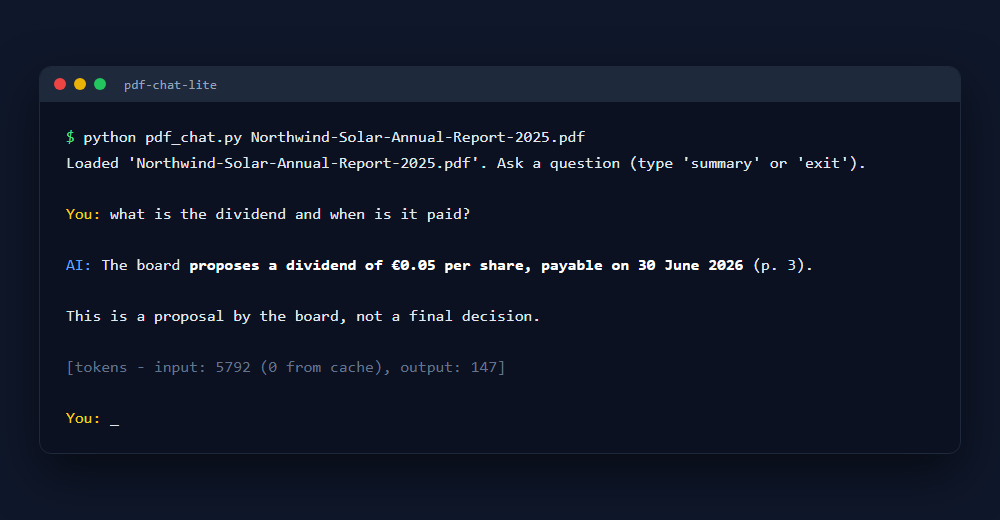
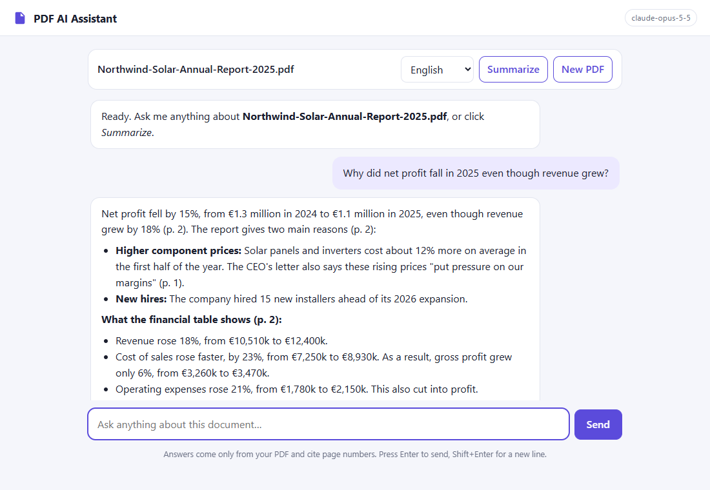

# pdf-chat-lite

Chat with any PDF from your terminal, powered by Claude. One Python file, about 150 lines.



- **Answers only from your document**, with page numbers like *(p. 3)*, so you can check every claim
- **Summaries in any language**: `--summary --lang German`
- **Reads text, tables, charts and scanned pages** (Claude's native PDF support, no text extraction)
- **Cheap follow-ups**: the PDF is cached with prompt caching, so follow-up questions cost a fraction of the first
- **Streams answers** as they are written
- Says so when the answer isn't in the document, instead of guessing

## Quick start

```bash
git clone https://github.com/momchilborisov05-eng/pdf-chat-lite.git
cd pdf-chat-lite
pip install -r requirements.txt
cp .env.example .env        # Windows: copy .env.example .env
# add your API key from https://console.anthropic.com to .env

python pdf_chat.py docs/sample-report.pdf
```

`docs/sample-report.pdf` is a 3-page annual report of a fictional company, so you can try it right away.

```bash
python pdf_chat.py contract.pdf                          # interactive chat
python pdf_chat.py report.pdf --summary                  # summary
python pdf_chat.py report.pdf --summary --lang Bulgarian # summary in another language
```

In the chat, type `summary` for a summary or `exit` to quit.

## How it works

1. The PDF is base64-encoded and sent as a `document` content block, with `cache_control` so it's cached.
2. A system prompt tells the model to answer only from the document and to cite pages.
3. The whole conversation is sent on every turn, so follow-ups like *"explain the second point"* work.
4. After the first question, the PDF is read from the cache, which costs about 10× less than reading it fresh.

Limits: 32 MB and about 600 pages per PDF (Claude API limits).

## Cost

You pay Anthropic per token. A page is usually 1,500–3,000 input tokens. For a 20-page PDF, the first question costs roughly $0.15–0.30 with `claude-opus-5-5`, and follow-ups cost a few cents. Set `CLAUDE_MODEL=claude-sonnet-5-5` in `.env` for about half the price.

## Want the web app?

**[PDF AI Assistant Kit](https://borisov1.gumroad.com/l/pfjmyv)** is the full version of this project:



- Web interface: drag-and-drop upload, streaming chat, light and dark mode, works on phones
- One-click summaries in 9 languages
- Demo mode, so you can try the interface without an API key
- Clean Flask + JavaScript code with automated tests, ready to customize for client projects
- Step-by-step guide for Windows and macOS: setup, costs, customization, troubleshooting

Launch discount: **[$10 off with code LAUNCH10](https://borisov1.gumroad.com/l/pfjmyv/LAUNCH10)** until November 9, 2026.

## License

MIT. Use it however you like. See [LICENSE](LICENSE).

Made by Momchil Borisov.
